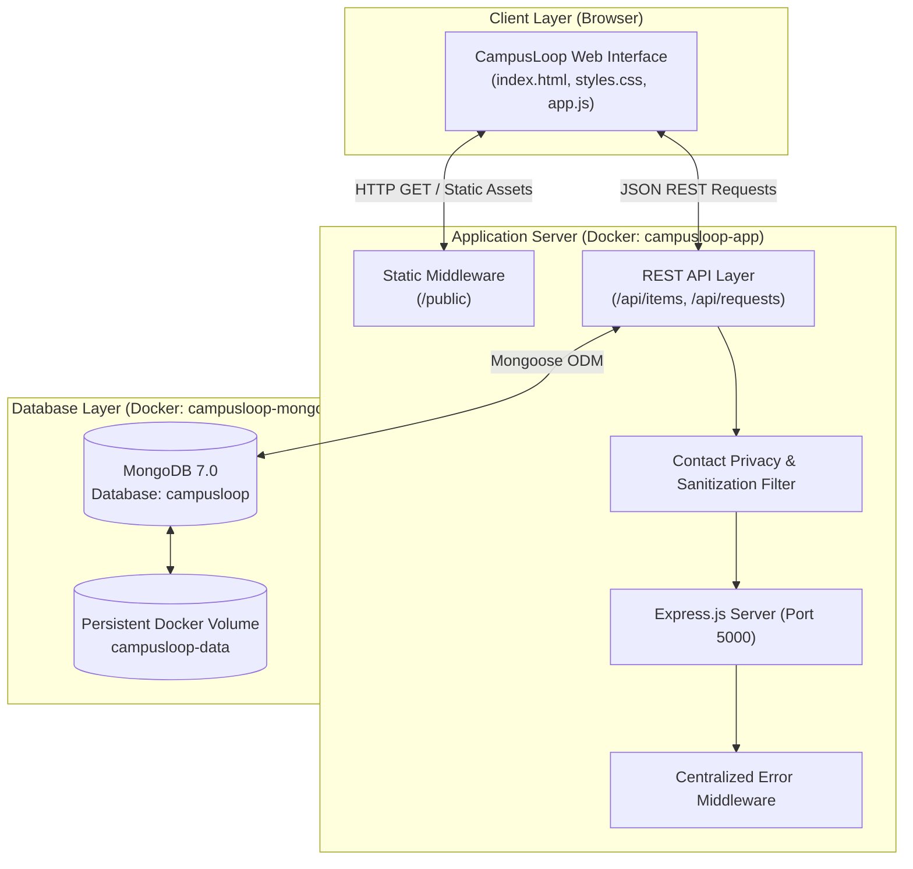
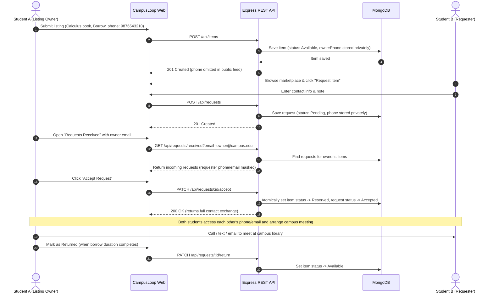

# CampusLoop — Student Exchange Network

> A peer-to-peer campus marketplace empowering students to discover, lend, borrow, sell, and exchange essential academic resources.

[](https://nodejs.org/)
[](https://expressjs.com/)
[](https://www.mongodb.com/)
[](https://www.docker.com/)
[](LICENSE)

---

## 1. Introduction

**CampusLoop** is a campus-only student marketplace engineered to facilitate the sharing, lending, selling, and exchange of college essentials. Students can list textbooks, graphing calculators, laboratory equipment, electronics, and drafting tools that they no longer actively use, allowing fellow students to obtain needed academic resources quickly, affordably, and sustainably.

---

## 2. Background & Motivation

At the start of every academic semester, students spend substantial sums on textbooks, lab kits, calculators, and tools that are utilized for only a few months. Once coursework is completed, these items typically sit unused in dormitories. At the same time, newly enrolled students pay retail prices for the exact same items. 

CampusLoop bridges this gap by creating a localized circular economy directly inside the campus ecosystem.

---

## 3. Problem Statement

Commercial marketplaces and e-commerce platforms do not serve student campus needs:
- They incur shipping fees and transit delays for exchanges between people located on the same campus.
- They charge platform transaction fees and commissions.
- They lack workflows tailored for temporary lending or borrowing arrangements.

---

## 4. Proposed Solution

CampusLoop provides an intuitive web platform where students can:
1. Publish available items with condition, listing type (`Sell`, `Borrow`, `Exchange`), and transparent pricing.
2. Search and filter listings in real time across academic categories.
3. Submit borrow, purchase, or exchange requests directly to listing owners.
4. Exchange contact details privately upon request acceptance to coordinate a face-to-face handover on campus.

> **Important Concept:** CampusLoop is **not** an e-commerce store. There are no online payment gateways, shipping mechanisms, or delivery tracking systems. The platform facilitates request coordination, after which students meet in person on campus to complete their transaction.

---

## 5. Project Objectives

- **Reduce Educational Costs**: Provide an affordable alternative to purchasing new semester materials.
- **Promote Sustainability**: Extend the usable lifecycle of textbooks, electronics, and campus supplies.
- **Ensure Contact Privacy**: Protect students' contact numbers from public display until a request is mutually confirmed.
- **Streamline Coordination**: Provide dedicated views for submitted requests and received requests.

---

## 6. Key Features

- **Item Listing**: Publish listings with title, description, category, condition, price, and private contact phone.
- **Marketplace Discovery**: Instant text search and dynamic filtering by category and transaction type.
- **Request Coordination**: Send structured requests with purpose explanations.
- **"My Requests" Dashboard**: Track personal outgoing requests and access owner contact information upon acceptance.
- **"Requests Received" Dashboard**: Group incoming requests by listed item, review student messages, and accept or decline requests.
- **Offline Contact Exchange**: Automatically displays verified contact links (`mailto:` and `tel:`) when a request is accepted.
- **Lifecycle Management**:
  - `Pending` → `Accepted` (reserves the item)
  - `Pending` → `Declined` (frees the item)
  - `Accepted` → `Completed` (closes the listing)
  - `Borrow` items → `Mark as Returned` (restores item to `Available` status)

---

## 7. Technology Stack

| Layer | Technology | Purpose |
|---|---|---|
| **Backend Runtime** | Node.js (v22 Alpine) | Non-blocking server-side execution environment |
| **Backend Framework** | Express.js (v5.1) | RESTful API routing, error middleware, and static asset delivery |
| **Database** | MongoDB (v7.0) | High-performance document database for persistent JSON records |
| **Object Data Modeling** | Mongoose (v8.18) | Schema validation, business logic enforcement, and data indexing |
| **Containerization** | Docker & Docker Compose | Multi-container orchestration, automated health checks, and volume persistence |
| **Frontend** | HTML5, CSS3, Vanilla JavaScript | Responsive single-page interface with real-time API integrations |

---

## 8. System Architecture



---

## 9. Application Workflow



---

## 10. Project Structure

```text
CampusLoop/
├── docs/
│   └── PROJECT_DETAILS.md        # In-depth technical architecture specification
├── public/
│   ├── index.html                # Semantic single-page HTML layout
│   ├── styles.css                # Responsive UI stylesheets and status badges
│   └── app.js                    # Client-side API integration and DOM updates
├── src/
│   ├── models/
│   │   ├── Item.js               # Mongoose schema for item listings
│   │   └── ExchangeRequest.js    # Mongoose schema for exchange requests
│   ├── routes/
│   │   ├── itemRoutes.js         # REST endpoints for marketplace items
│   │   └── requestRoutes.js      # REST endpoints for request lifecycle
│   └── server.js                 # Express server bootstrap & database connection
├── .dockerignore                 # Excluded build artifacts for Docker images
├── .env.example                  # Environment configuration template
├── .gitignore                    # Git file exclusion rules
├── docker-compose.yml            # Multi-container orchestration definition
├── Dockerfile                    # Container build configuration for Node.js
├── package-lock.json             # Locked dependency tree
├── package.json                  # Project manifest and scripts
└── README.md                     # Primary repository documentation
```

---

## 11. Prerequisites

Before running CampusLoop, ensure you have the following installed:
- [Docker Desktop](https://www.docker.com/products/docker-desktop/) (Version 24.0+ recommended)
- [Git](https://git-scm.com/) (Version 2.30+)
- *(Optional for non-Docker execution)*: [Node.js](https://nodejs.org/) v20+ and [MongoDB](https://www.mongodb.com/) v7.0+

---

## 12. Environment Configuration

CampusLoop uses environment variables for operational configuration. An example file `.env.example` is provided:

```ini
PORT=5000
MONGO_URI=mongodb://mongo:27017/campusloop
```

For standard Docker deployment, no manual edits are necessary because `docker-compose.yml` pre-configures these variables for container networking.

---

## 13. Installation & Execution

### Option A: Running with Docker (Recommended)

1. Clone the repository:
   ```bash
   git clone https://github.com/Sriikaran/CampusPool.git
   cd CampusPool
   ```

2. Build and launch all containers in detached mode:
   ```bash
   docker compose up --build -d
   ```

3. Check container status:
   ```bash
   docker compose ps
   ```

4. Inspect runtime logs:
   ```bash
   docker compose logs -f
   ```

5. Access CampusLoop in your web browser:
   👉 **http://localhost:5000**

6. To stop the containers while preserving all stored data:
   ```bash
   docker compose down
   ```

*(Note: Data is saved in the persistent volume `campusloop-data` and will remain intact across restarts).*

---

### Option B: Running Locally (Without Docker)

1. Ensure a local MongoDB daemon is running at `mongodb://127.0.0.1:27017`.
2. Copy the environment configuration:
   ```bash
   cp .env.example .env
   ```
3. Edit `.env` to point to your local database:
   ```ini
   PORT=5000
   MONGO_URI=mongodb://127.0.0.1:27017/campusloop
   ```
4. Install dependencies:
   ```bash
   npm ci
   ```
5. Start the server:
   ```bash
   npm start
   ```
6. Open **http://localhost:5000** in your browser.

---

## 14. REST API Overview

| Method | Endpoint | Description |
|---|---|---|
| `GET` | `/api/health` | Check service health and database connection status |
| `GET` | `/api/stats` | Fetch live available item and category metrics |
| `GET` | `/api/items` | List available items with optional `search`, `category`, and `type` queries |
| `GET` | `/api/items/:id` | Fetch full details for a single item (private contact info excluded) |
| `POST` | `/api/items` | Publish a new item listing |
| `PUT` / `PATCH` | `/api/items/:id` | Update an existing item's attributes |
| `DELETE` | `/api/items/:id` | Remove an item and cascade deletion to associated requests |
| `POST` | `/api/requests` | Submit an item exchange/borrow request |
| `GET` | `/api/requests?email=` | View requests submitted by a student ("My Requests") |
| `GET` | `/api/requests/received?email=` | View incoming requests for an owner's items, grouped by item |
| `PATCH` | `/api/requests/:id/accept` | Accept request, reserve item, and reveal mutual contact details |
| `PATCH` | `/api/requests/:id/decline` | Decline request and protect contact information |
| `PATCH` | `/api/requests/:id/complete` | Complete offline exchange and close listing |
| `PATCH` | `/api/requests/:id/return` | Mark borrowed item as returned, making it available again |

---

## 15. Security & Privacy Considerations

- **Contact Masking**: Listing phone numbers are never returned in public marketplace queries (`.select('-ownerPhone')`).
- **Conditional Disclosure**: Requester phone numbers and emails are only unlocked after the listing owner clicks "Accept Request".
- **Concurrency Protection**: Atomic MongoDB updates (`findOneAndUpdate({ _id, status: 'Available' }, { status: 'Reserved' })`) prevent double-booking or race conditions between simultaneous requests.
- **Input Validation**: Strict schema checks, email format validation, positive price bounds, and rejection of self-requests.

---

## 16. Current Limitations & Future Roadmap

- **Identity**: Currently utilizes campus email verification without requiring passwords. Future versions will incorporate institutional Single Sign-On (SSO).
- **Media**: Utilizes category icon visualizers. Future versions will support camera/photo attachments with cloud storage.
- **Campus Safety Zones**: Future roadmap includes suggesting designated secure campus meeting locations (e.g., student union or library security desks).

---

## 17. Supporting Documentation

For comprehensive technical specifications, database schema diagrams, and endpoint lifecycle rules, see:
📖 [Detailed Technical Documentation](docs/PROJECT_DETAILS.md)

🎥 [Project Video Explanation](docs/CampusLoop_Project_Video_Explanation.mov)

---

## 18. Author & License

Developed for student communities by **Sriikaran** ([@Sriikaran](https://github.com/Sriikaran)).  
Distributed under the [MIT License](LICENSE).
